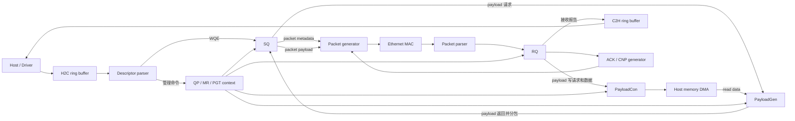

# Old RDMA BSV 阅读与新 RDMA 设计规范

本文根据 `old-rdma/src` 中的 Bluespec SystemVerilog（BSV）源码整理，目标是给新的 RDMA 设计提供一份可以执行的编码和架构约定。

文档中的结论分为两类：

- **旧设计事实**：源码已经采用的组织方式和数据通路。
- **新设计建议**：值得保留的做法，以及应当修正的历史问题。

“BSV 能编译”不等于“能映射到 FPGA”，也不等于“能达到目标频率”。新设计必须分别通过 BSC 编译、综合、时序分析和布局布线验证。

**本次是源码静态阅读与设计规范整理，未运行 BSC、仿真、FPGA 综合或布局布线；不出具“已通过综合”的结论。** 文中的可综合性要求是以后需要执行的验收条件，示例中未定义的接口和类型属于结构示意。

## 1. 阅读范围和代码树

主要分析树是 [`old-rdma/src`](old-rdma/src)。递归共有 **47 个 BSV 文件：根目录 42 个、vendor 目录 5 个**，覆盖协议类型、SQ/RQ、DMA、ring buffer、QP/MR/PGT、MAC/PCIe 适配和顶层连接。

仓库中还存在 [`old-rdma/open-rdma-rtl/src`](old-rdma/open-rdma-rtl/src)，递归有 48 个 BSV。两树同相对路径的文件中有 **33 个文件 SHA256 不同**，后者另有 `Fifo_plus.bsv`，因此不能假定两者完全等价。嵌套树还把 `MAX_QP` 从 1024 改为 32、PGT 容量从 2^17 改为 2^7，并有 `PipeSink` 接口迁移。本文以外层 `src` 为主；移植时必须明确实际构建选用哪棵树，不混用两个版本的模块。

建议按以下顺序阅读旧代码：

1. [`Settings.bsv`](old-rdma/src/Settings.bsv)、[`BasicDataTypes.bsv`](old-rdma/src/BasicDataTypes.bsv)：参数和类型。
2. [`ConnectableF.bsv`](old-rdma/src/ConnectableF.bsv)、[`DtldStream.bsv`](old-rdma/src/DtldStream.bsv)、[`IoChannels.bsv`](old-rdma/src/IoChannels.bsv)：流接口和 DMA 接口。
3. [`RdmaHeaders.bsv`](old-rdma/src/RdmaHeaders.bsv)、[`EthernetTypes.bsv`](old-rdma/src/EthernetTypes.bsv)：协议字段。
4. [`SQ.bsv`](old-rdma/src/SQ.bsv)、[`PacketGenAndParse.bsv`](old-rdma/src/PacketGenAndParse.bsv)、[`PayloadGenAndCon.bsv`](old-rdma/src/PayloadGenAndCon.bsv)：发送路径。
5. [`RQ.bsv`](old-rdma/src/RQ.bsv)、[`AutoAckGenerator.bsv`](old-rdma/src/AutoAckGenerator.bsv)、[`CnpPacketGen.bsv`](old-rdma/src/CnpPacketGen.bsv)：接收和控制包路径。
6. [`Ringbuf.bsv`](old-rdma/src/Ringbuf.bsv)、[`DescriptorParsers.bsv`](old-rdma/src/DescriptorParsers.bsv)：主机队列和描述符。
7. [`QPContext.bsv`](old-rdma/src/QPContext.bsv)、[`MemRegionAndAddressTranslate.bsv`](old-rdma/src/MemRegionAndAddressTranslate.bsv)：上下文和地址转换。
8. [`Top.bsv`](old-rdma/src/Top.bsv)、[`Top100G.bsv`](old-rdma/src/Top100G.bsv)、[`TwoChannelBuildBlock.bsv`](old-rdma/src/TwoChannelBuildBlock.bsv)：系统级连接。
9. `vendor/` 下的 BVI 和厂商适配器：最后阅读，避免平台细节干扰协议理解。

## 2. 旧设计的总体架构

旧设计是使用 Ethernet/IP/UDP 封装、带有私有 RDMA 协议扩展的网卡数据通路。它复用了大量 RoCE/RDMA 概念，但源码不能证明与标准 RoCE 网卡直接互通。主要连接可以画成：



### 2.1 发送方向

1. 主机把 WQE 写入 H2C ring buffer。
2. ring buffer 通过 DMA 读取描述符，`DescriptorParsers` 解出 `WorkQueueElem`。
3. `SQ` 把 WQE 交给 `PacketGen`。
4. `PacketGen` 查询 MR，按远端地址与 PMTU 分包，并请求 `PayloadGen` 读取主机 payload。
5. `PayloadGen` 再按 PCIe burst 拆分本地访问，做 VA 到 PA 的 PGT 转换，产生 DMA read 请求并接收数据流。
6. `PacketGen` 生成 BTH、RETH/RRETH 等扩展头和精简网络元数据；实际 Ethernet/IP/UDP 头由 `EthernetFrameIO256.bsv` 的 packet generator 组装。
7. 发送元数据和 payload 进入以太网 packet generator，最后送到 MAC。

### 2.2 接收方向

1. MAC 将 Ethernet 数据流送入 `PacketParse`。
2. parser 按 MAC/IP/UDP/RoCEv2 分类，提取 BTH、扩展头和 payload。
3. `RQ` 查询 QPC 和 MR，实施 QPN/key、权限、地址范围及部分 opcode/长度检查；是否完整需逐分支审计。它没有在 payload 写入前通过 PSN bitmap 去重或阻挡乱序包。
4. 合法 payload 交给 `PayloadCon`；它完成分块、PGT 转换和 DMA write。
5. RQ 生成接收元数据报告，经 C2H ring buffer 上报软件。它不是对所有操作都表示“整条消息已完成”的标准 CQE。
6. 对符合条件的包，RQ 在消费 payload 后请求更新 ACK bitmap；对 ECN 标记且不是 CNP 的包请求生成 CNP。

这里有一个重要设计原则：**头部元数据和 payload 数据是两条相关但独立的流**。新设计不应只传一个“大包结构体”，否则很难做 DMA、背压、分片和流水化。

### 2.3 必须先确定协议边界

源码证据见 `RdmaHeaders.bsv` 的 `BTH/AETH` 和 `PacketGenAndParse.bsv` 的 `genRdmaHeader`：

- BTH 中含 `msn` 和 `isRetry`，不能直接套用标准 BTH 字段解释。
- AETH 保存前后两张 128-bit bitmap，加标志和 PSN，实际为 **36 字节**；源码“38 bytes”注释已过时。它不是标准 4 字节 AETH。
- WRITE/SEND/READ_RESPONSE 的分包采用每包携带 RETH 的私有格式；READ_REQUEST 还携带 RRETH，描述返回地址和 lkey。
- READ 请求会转成软件报告，不能据此声称已有完整的硬件自动 READ responder。
- Atomic opcode、类型和头生成存在，不代表接收端已实现完整原子执行及结果返回。

新设计应先选定“兼容标准 RoCE”或“保留本项目私有协议”，再定义 packet ABI、驱动接口和验证样例。不要仅按旧类型名复制线上的字节布局。

## 3. BSV 文件和模块组织

旧代码常见的文件骨架是：

```bsv
import A :: *;
import B :: *;

typedef ...;
typedef struct { ... } SomeMeta deriving(Bits, FShow);
typedef enum { ... } SomeState deriving(Bits, Eq, FShow);

interface SomeIfc;
    ...
endinterface

(* synthesize *)
module mkSomeModule#(SomeParam p)(SomeIfc);
    ...
endmodule
```

这个结构清楚，值得保留。新设计每个文件应尽量只承担一个主题：

- `settings/`：平台参数和协议参数。
- `types/`：公共 bit 类型、协议头、descriptor。
- `stream/`：FIFO、流转换、仲裁。
- `protocol/`：QP、PSN、ACK、opcode 状态机。
- `memory/`：MR、PGT、BRAM、DMA。
- `packet/`：Ethernet/RoCE parser 和 generator。
- `platform/`：PCIe、MAC、厂商 BVI。
- `top/`：只做实例化和连接，不放协议细节。

旧代码大量使用 `import X :: *`。它写起来方便，但依赖不透明。新设计应优先显式导入，或者至少通过模块分层控制可见名称；同一文件重复导入（例如部分文件重复导入 `RdmaHeaders`）应由 lint 检查拦截。

## 4. 参数、宏和类型系统

### 4.1 旧设计的做法

[`Settings.bsv`](old-rdma/src/Settings.bsv) 主要使用 BSV 的 type-level `typedef`，而不是到处写 Verilog `` `define``。例如：

```bsv
typedef 256 DATA_BUS_WIDTH;
typedef 1024 MAX_QP;
typedef 8192 MAX_MR;
typedef 4 HARDWARE_QP_CHANNEL_CNT;
typedef TExp#(17) MAX_PTE_ENTRY_CNT;
typedef `PCIE_MAX_BEAT_CNT_IN_BURST PCIE_MAX_BEAT_CNT_IN_BURST;
```

随后用 `TAdd`、`TSub`、`TMul`、`TDiv`、`TExp`、`TLog` 推导宽度，并通过 `valueOf(...)` 得到编译期整数；要送入硬件表达式时，再用 `fromInteger(...)` 转成目标宽度的常量。这里没有运行时修改总线宽度的能力。[`BasicDataTypes.bsv`](old-rdma/src/BasicDataTypes.bsv) 再把这些宽度变成 `Bit#(...)` 类型，例如 `DATA`、`PADDR`、`PTEIndex`、`PktFragNum`。

这种方式的优点是总线宽度和字段宽度可以沿类型系统传播，很多非法连接会在编译期暴露。`struct deriving(Bits, FShow)` 也使得协议结构可以直接打包到硬件总线，并且方便仿真打印。

但是 `typedef Bit#(64) VirtAddr` 与 `typedef Bit#(64) PhysAddr` 只是别名，不能依靠名字阻止互相赋值。若新设计需要防止 VA/PA 混用，应采用单字段 `struct` 等独立类型并只开放明确的转换函数。

索引和数量也不能混用：容量为 256 时，索引 `0..255` 用 8 位，表示占用数量 `0..256` 需要 9 位。一般用 `TLog#(capacity)` 表示索引宽度，`TLog#(TAdd#(capacity, 1))` 表示计数宽度；还要单独处理 capacity=0/1、非 2 的幂以及非法索引。

### 4.2 新设计的参数分层

不要把所有数字都放进一个 Settings 文件。建议分成三层：

| 参数层 | 例子 | 影响 |
| --- | --- | --- |
| 协议常量 | BTH 字段宽度、UDP 端口、PSN 宽度 | 不能随平台任意改变 |
| 微架构参数 | FIFO 深度、流水级数、ACK window | 影响吞吐、延迟和资源 |
| 平台参数 | PCIe beat、MAC 宽度、时钟频率、通道数 | 由 FPGA/IP 核决定 |

每个参数都要写明单位、合法范围、是否必须为 2 的幂、预计资源影响。`MAX_QP=1024`、`MAX_MR=8192`、`MAX_PTE_ENTRY_CNT=2^17` 这类数字直接决定 BRAM/寄存器规模，不能只当作软件配置。

### 4.3 宏的边界

旧代码用少量外部 Verilog 宏选择 PCIe IP 类型和宽度，例如 ``PCIE_MAX_BEAT_CNT_IN_BURST``。这种做法可以复用不同平台，但编译契约不明显。新设计应做到：

1. 为每个外部宏提供默认值或明确的构建错误。
2. 在一个平台配置文件中集中定义宏，不允许业务模块自行判断大量 `ifdef`。
3. 把 `ifdef` 限制在 `platform/` 适配层。
4. 对宏的值做静态检查，防止数据宽度、地址宽度和 FIFO 深度不匹配。

旧项目的宏来源是 `old-rdma/Makefile.base` 的 BSC `-D` 参数。不要额外假定 `Settings.bsv` 会自动 include 某个宏文件。尤其要核对构建变量和 BSV 真正使用的值：`BLUERDMA_DATA_BUS_WIDTH` 变量并没有自动替换外层 `Settings.bsv` 中写死的 `typedef 256 DATA_BUS_WIDTH`。

`PcieMacros.bsv` 中的通配 case 字面量（如 `5'b10???`）只能用于 case 匹配，不能把它当普通的硬件枚举值使用。

### 4.4 位宽和截断规则

旧代码大量使用 `truncate`、`truncateLSB`、`zeroExtend`、`signExtend`、`pack/unpack`。这在地址分块、byte lane 对齐和协议打包中是必要的，但每次截断都可能丢数据。

新设计每次截断都必须说明：

```bsv
// 低 5 位是 32-byte beat 内偏移；高位作为 beat 地址，故这里只保留低位。
BusByteIdx byteOffset = truncate(addr);
```

禁止用 `unpack(?)` 或 `?` 作为默认修复手段。只有在该字段被明确屏蔽、不会送到可观察输出，并且有断言保证时，才允许使用 don't-care。

旧代码中存在 `BYTE_CNT_PER_WOED`、`DWOED` 等拼写和重复概念。新设计应一次定义 `BYTES_PER_DWORD`，并使用全局一致的名称。

### 4.5 pack、端序和接口布局

`deriving(Bits)` 规定如何把结构打包成位串，不会自动把主机字节序变成网络字节序，也不会校验保留位。外部 descriptor/packet ABI 必须明确字段偏移、总宽度、有效字节位置以及 byte swap 所在的边界。

旧 `RdmaUtils.bsv` 从扩展头 buffer 的高位提取 RETH/AETH；`PrimUtils.bsv` 的 `zeroExtendLSB(bits)` 实际返回 `{ bits, 0 }`，即**有效字段放高位、低位补零**。不能根据函数名字猜端序。

`ReservedZero#(n)` 表达保留位意图，但发送时仍要赋零，接收时按协议决定是否检查。`Bounded`/`unpack(0)` 也不自动等于“语义合法的默认协议对象”。

## 5. 命名、缩进和格式

### 5.1 应保留的命名模式

旧代码的这些规则很有用：

| 对象 | 推荐命名 | 例子 |
| --- | --- | --- |
| 类型 | PascalCase | `WorkQueueElem`、`RdmaRecvPacketMeta` |
| 接口 | PascalCase + `Ifc` 可选 | `PacketParse`、`AddressChunker` |
| 构造器 | `mk` + PascalCase | `mkPacketGen` |
| 寄存器 | 语义名 + `Reg` | `busyReg`、`nextAddrReg` |
| FIFO | 语义名 + `Q` | `reqQ`、`respQ` |
| 常量 | 全大写下划线 | `MAX_QP`、`DATA_BUS_WIDTH` |
| 函数 | camelCase，动词开头 | `getIndexQP`、`genQPN` |
| rule | 动词 + 对象 | `sendQpcQueryReq`、`forwardMetaReportDesc` |

接口中要体现方向和含义，例如 `payloadGenReqPipeOut`、`dmaReadRespPipeIn`。不要使用只在当前作者脑中有意义的 `q0`、`tmp2`、`x`。

### 5.2 新设计必须统一的地方

旧代码有 `QPN/qpn`、`qpIndex/qpnIdx`、`addr/address`、`resp/response`、`ifc/Ifc` 等混用，也保留了 `PsnContinousChecker` 这样的历史拼写。新设计应建立名称表并由 review 检查：

- QP 编号统一用 `qpn`，表索引统一用 `qpIndex`。
- 物理地址统一用 `physAddr`，虚拟地址统一用 `virtAddr`。
- 请求/响应统一用 `req`/`resp`。
- 接口类型统一使用 `Ifc` 或完全不用，不能混用。
- 协议字段名称保留规范缩写（如 `PSN`、`QPN`），局部变量采用小写。

### 5.3 格式

旧代码大体使用 4 空格，模块和 rule 的层次清楚，但仍有 tab、尾随空格、连续空行、过长声明和大量注释掉的旧连接代码。新仓库应启用 formatter/lint：

- 只用 4 个空格，禁止 tab。
- 禁止尾随空白。
- 一个模块只保留一个正式实现；废弃实现移到历史文档。
- 长类型和长 `mkConnection` 分行，连接两端对齐。
- 每个 `rule` 只做一件主要工作，并写出它消费和产生的队列。

## 6. 接口和握手

### 6.1 `PipeIn`、`PipeOut` 和 `PipeInB0`

[`ConnectableF.bsv`](old-rdma/src/ConnectableF.bsv) 是旧设计的接口基础：

- `PipeIn#(T)`：带 `enq` 和 `notFull` 的输入；是否有物理 FIFO 由实现决定，接口类型本身不规定容量。
- `PipeOut#(T)`：带 `first`、`deq` 和 `notEmpty` 的输出。
- `PipeInB0#(T)`：零缓冲输入，通过 `firstIn`、`notEmptyIn`、`deqSignalOut` 传递 ready/dequeue。
- `ServerP#(Req, Resp)`：请求输入 + 响应输出。
- `ClientP#(Req, Resp)`：请求输出 + 响应输入。

`mkConnection` 可以自动连接这些接口。旧设计通过 `ServerP/ClientP` 统一 QPC、MR、PGT 等查询，代码比手工传多条 FIFO 更容易复用。

但 `PipeInB0` 没有内部缓冲，组合路径和调度关系更敏感。新设计必须在接口名称或注释中写清楚它是：

1. 零缓冲组合连接；
2. 单级流水；
3. 有限 FIFO；
4. 跨时钟域同步 FIFO。

不能只因为 `mkConnection` 能编译，就假定它具有背压或时序隔离。

### 6.2 RPC 查询的配对关系

旧代码用 `QueuedClientP` 把请求和响应排成 FIFO，并在 QPC、MR、PGT 查询中保持顺序。新设计必须明确：

- 响应是否严格按请求顺序返回；
- 是否允许多个 outstanding request；
- 响应如何与请求关联；
- 请求 FIFO 满时，上游如何停顿；
- reset 时是否丢弃已有请求。

如果后端允许乱序返回，应在请求中加入 tag，不能靠“通常会按顺序”工作。

## 7. rule、method、function 的设计

### 7.1 旧代码的流水线写法

`RQ` 把接收处理拆成多个 rule 和 pipeline FIFO：

1. `sendQpcQueryReqAndSomeSimpleParse`：提取 BTH/RETH，发起 QPC/MR 查询。
2. `checkQpcAndMrTable`：检查 QP key、QP 权限和 MR key。
3. `checkMrTableStep2`、`checkMrTableStep3`：检查地址边界和 payload beat 数。
4. `issuePayloadConReqOrDiscard`：决定写 DMA 或丢弃。
5. `handleConResp`：等待 payload consume 完成。
6. `genMetaReportQueueDesc`：生成给软件的接收元数据报告。

这种“一个大业务步骤拆成多个小 rule”的方式可以把 BRAM latency、DMA latency 和网络流解耦，值得保留。

### 7.2 rule 的建议模板

每个 rule 应尽量有一个明确的输入和输出：

```bsv
rule issueRead if (reqQ.notEmpty && addrQ.notFull);
    let req = reqQ.first;
    reqQ.deq;
    addrQ.enq(makeReadMeta(req));
endrule
```

建议：

- 在 rule guard 中表达资源条件，避免进入 rule 后才发现 FIFO 满。
- 在事务真正消费时才 `deq`。跨多个 chunk 的请求可以有意保留在队首直到最后一个 chunk；不能为了格式统一而提前出队，丢掉与后续数据的关联。
- 对同一个寄存器被多个 rule 写入的情况，明确优先级或合并写入。
- 不要在同一个 rule 中混合协议决策、复杂动态移位和大量调试打印。
- 协议分类/地址计算等纯函数只做组合计算。BSV 也合法支持返回 `Action`/`ActionValue` 的函数，旧代码的断言和 CSR matcher 就使用这种形式；这类函数须明确命名并在 rule/method 中调用，不能误称为无副作用。

BSV 的 rule 不是软件线程：一次 firing 中的受保护动作作为一个原子事务调度。对普通 `mkReg`，`<=` 写入在时钟边沿提交，同一 rule 里继续读取通常仍是旧值；局部变量 `=` 只构造本次计算的表达式，`<-` 则用于实例化模块或取得 ActionValue 结果，取决于所在上下文。

因此，同一原子 rule 中 `q.deq; let x = q.first;` 通常读到的是该次出队的队首，并不是软件意义上的“下一个元素”。可以为了阅读习惯先写 `first` 再写 `deq`，但不能按 C++ 顺序执行模型推断硬件。`mkCReg`/EHR 和 bypass FIFO 还有额外的同周期顺序契约，须查看调度关系。

### 7.3 调度和冲突

BSV 编译器会检查 rule 的隐含条件和冲突，但仍要阅读 schedule warning。重点审计：

- 两个 rule 是否同时写同一寄存器。
- 同一 FIFO 是否同周期发生不允许的 enq/deq 组合。
- 一个 BRAM 是否被多个客户端同时访问。
- `descending_urgency` 是否掩盖了长期饥饿。
- rule 的 guard 是否导致 `no-rule-never-fires`。

旧代码中有多层 arbiter 和显式优先级。新设计应集中声明调度策略，并记录公平性目标，例如“最高等待不超过 N 个周期”。

这个等待上界必须有条件：例如其他请求的最大长度有限、下游每隔若干周期能接收。如果下游可以无限背压，仲裁器本身无法保证绝对等待周期。`no_implicit_conditions`、`fire_when_enabled`、BVI 的 `CF/SB/C` 都是调度契约，不能用来强行掩盖资源冲突。

## 8. FIFO、流和仲裁

### 8.1 FIFO 的语义

旧代码使用 `mkFIFOF`、`mkLFIFOF`、`mkSizedFIFOF`、`mkUGLFIFOF`、`mkBypassFIFOF`、`mkSyncFIFO` 等多种实现。新设计不能只按名字选择，应给每个 FIFO 写一行设计说明：

```text
用途：保存 PCIe read metadata
深度：16
允许同时 enq/deq：是
是否需要旁路：否
时钟域：user_clk
满时行为：上游停止发请求
```

特别注意 `UG` 和 bypass FIFO 的 ready 语义，不能把它们当普通 FIFO 替换。

`UG` 表示取消部分方法保护，并不表示可以溢出或空读；`LFIFOF` 也不是“保证整条流水线无气泡”的证明。`mkRegisteredSizedFIFOF` 在旧 `PrimUtils.bsv` 中还会分解为输入、内部 buffer、输出 FIFO。替换 FIFO 时要同时复核空/满时的同周期 enq/deq、前向数据路径、反向背压路径和 response 到达时限。

旧 `FullyPipelineChecker` 的 FullAssert wrapper 会把“FIFO 满”本身当错误。在普通弹性流水中，满并随后施加背压可以是合法状态；更通用的断言应检查“满时仍无保护写入”。只有对明确承诺永不阻塞的接口，才应要求永不满。

### 8.2 多 beat 请求必须锁住 owner

[`Arbitration.bsv`](old-rdma/src/Arbitration.bsv) 的核心原则是：仲裁成功后记录当前 owner，在 `isReqFinished` 为真之前继续服务同一个 client。对于 DMA burst、packet payload 和 descriptor 多 beat 流，这是必须的；如果 beat 与 beat 之间重新仲裁，可能把两个 packet 拼在一起。

新设计应明确：

- request 的开始和结束条件；
- response 是否也要保持顺序；
- 固定优先级是否会饿死其他通道；
- round-robin 指针何时前进；
- 多层仲裁带来的组合路径和额外延迟。

### 8.3 stream metadata

`DtldStream` 为每个数据 beat 携带 `data`、有效字节数、起始 byte、`isFirst`、`isLast` 等信息。它能表示非对齐地址、短尾 beat 和跨 burst 的 payload。新设计应保持“数据 beat + 明确边界元数据”的模型，禁止让消费者猜包尾或根据长度自行推断 `isLast`。

## 9. SQ、PacketGen 和 Payload DMA

### 9.1 SQ 的定位

[`SQ.bsv`](old-rdma/src/SQ.bsv) 基本是 `mkPacketGen` 的薄封装：接收 WQE，输出 Ethernet metadata、RDMA packet metadata、payload 流，并暴露 MR 查询和 payload DMA 请求。本文件没有独立实现完整的 SQ 调度、重传或可靠连接状态机；不能凭模块名推断这些能力。

### 9.2 PacketGen 的逻辑

`PacketGenAndParse.bsv` 的发送侧大致经过以下阶段：

1. 查询 MR，使用表项中的 base VA 和 PGT offset；发送侧 MR 失败路径仍主要依赖仿真断言，不能据此认为权限和地址范围已完整验证。
2. 根据远端地址和 PMTU 生成 packet chunk。
3. 请求 `PayloadGen` 从主机内存取 payload。
4. 生成 BTH、RETH/RRETH、立即数等扩展头。
5. 通过 stream splitter 按 packet 边界切开 payload。

地址 chunker 的模式是“输入请求 → 预计算 → 状态机逐块输出”。[`AddressChunker.bsv`](old-rdma/src/AddressChunker.bsv) 用 `busyReg`、剩余长度和下一个地址保存跨周期状态；单块请求同时标记 `isFirst` 和 `isLast`。这是新设计应保留的结构。

必须补齐的边界检查包括：length=0、chunk shift 越界、地址加法溢出、最后一块长度、PMTU 小于总线 beat，以及首尾 byte 对齐。

### 9.3 PayloadGen / PayloadCon

[`PayloadGenAndCon.bsv`](old-rdma/src/PayloadGenAndCon.bsv) 将 payload DMA 拆成两条对称路径：

- `PayloadGen`：WQE 地址 → chunker → PGT query → DMA read metadata → stream concator。
- `PayloadCon`：RQ payload → stream splitter → chunker/PGT query → DMA write metadata/data。

旧代码为 DMA metadata 和 data 使用独立 FIFO，并用 pipeline FIFO 保存“当前 chunk 对应的 PGT response、长度和 first/last 信息”。新设计要保留这种关联，但建议用显式 tag 或结构体保存关联关系，减少靠多个 FIFO 的隐式位置配对。

`PayloadCon` 中的 reserved FIFO 用于先预留一个完成响应槽，再在最后一个数据 beat 消费后真正入队。这个做法能防止“请求已经接受，但响应 FIFO 满导致死锁”，值得保留；同时要对 reserve/enq/deq 的计数关系写断言。

### 9.4 “完成”必须说明完成到哪一步

`PayloadGenAndCon.bsv` 的 `forwardConsumedFinishedSignal` 在输入 payload 最后一拍进入内部 splitter 时就产生 `conResp=True`，此时数据还可能没有离开 DMA 队列。`Ringbuf.bsv` 的转换器也会在数据进入内部输出队列时构造 write response。因此建议区分：

| 事件名称 | 实际含义 | 能否直接承诺主机可见 |
| --- | --- | --- |
| `payloadAccepted` | payload 已被本地 buffer/splitter 接受 | 不能 |
| `dmaIssued` | 请求和数据已交给 DMA 接口 | 不能 |
| `dmaCompleted` | DMA 引擎按其契约报告完成 | 取决于引擎、总线排序和平台 |
| `hostVisible` | 满足目标平台内存可见性及发布顺序要求 | 才能用于相应软件完成契约 |

新设计需要明确 payload 写、接收 bitmap 更新、ACK 发出、报告 descriptor 发布之间的顺序。尤其 PCIe posted write 没有天然的一包一条 completion；不能凭一个本地 `Bool` 就认定远端 CPU/GPU 可以读取。

## 10. RQ、QP、MR、PGT 和协议状态

### 10.1 RQ 的安全边界

RQ 是接收端的安全检查边界。它不能信任包头中的长度或地址。旧代码也在注释中指出，非法长度必须处理，否则相关队列不出队会造成死锁。

新 RQ 至少要按以下顺序检查：

1. Ethernet/IP/UDP/RDMA 头格式和实际收到的 beat 数。
2. QPN 索引范围和 QP key。
3. opcode 与 QP 状态是否匹配。
4. RQ 权限、MR key、MR 是否存在。
5. 起始地址是否不低于 MR base。
6. `start + length - 1` 是否不越过 MR 上界，且加法没有溢出。
7. payload beat 数是否与头部长度和 `isFirst/isLast` 一致。
8. 非法包的所有关联流是否都被消费、丢弃或显式终止。

错误统计寄存器（invalid QP、invalid opcode、invalid MR key、越界、header error、packet length error 等）是很好的可观测性设计。新设计应统一错误码和计数器，而不是在不同 rule 中随意 `$display`。

### 10.2 QP Context

[`QPContext.bsv`](old-rdma/src/QPContext.bsv) 用 BRAM 风格存储 QPC，并通过 `ServerP/ClientP` 提供查询和修改。多路查询版本通过 arbiter 共享存储端口。设计要点是：

- QPN 到存储地址的映射必须是显式的。
- 读 latency 必须写进接口契约。
- 修改和查询同时发生时要定义 old/new value 语义。
- QP reset 要清理 PSN、ACK bitmap、重试状态和 pending 请求。

### 10.3 MR 和 PGT

[`MemRegionAndAddressTranslate.bsv`](old-rdma/src/MemRegionAndAddressTranslate.bsv) 将 MR table 与 page table 分开：MR 保存 base VA、length、access flags、key 和 PGT offset；PGT 把 VA 页号转换为物理页号。`mkBramCache` 用 **高地址位 `truncateLSB` 选择 bank、低地址位 `truncate` 作为 bank 内地址**，随后用 order queue 记录应当从哪个 bank 取 read response。

这里的 bank 拆分不能自动等同多请求并发：当前包装层每周期只发一个读请求，返回还受队首 bank 限制。真正的多查询服务还用了仲裁和整表复制。新设计先回答：

- 每个 bank 是否真的能同时工作；
- 同地址 read/write 冲突的语义是什么；
- bank 数增加后资源和布线是否可接受；
- response 顺序恢复 FIFO 是否足够深。

旧 `mkQpContextFourWayQuery` 复制两份双查询表；`mkMemRegionTableEightWayQuery` 和 `mkAddressTranslateEightWayQuery` 各复制四份双查询表，更新向副本广播。它们读取 0 号副本的部分握手/响应，依赖所有副本锁步；新设计应保证全部副本接受更新再确认完成，或者证明并监视它们始终同步。

## 11. ACK、PSN 和 CNP

`AutoAckGenerator` 通过 PSN bitmap 记录接收情况，同时维护时间和 MSN。必须区分它的三类行为：

| 旧代码触发条件 | 旧代码实际动作 | 新设计注意事项 |
| --- | --- | --- |
| 窗口内收到 PSN | 合并 bitmap，更新接收状态 | bitmap 不是 payload 排序缓存，也没有阻止之前的 DMA 写入 |
| `isShiftWindow && windowShiftedOutData != -1` | `needSendAckNow=True`，产生线上私有 `ACKNOWLEDGE` 和软件报告 | 这是“窗口滑动且移出部分存在缺口”，不是任意乱序或任意滑动都立即发 ACK |
| 后台轮询发现超时 | 写入 `pollingTimeoutDescQueue`，上报软件 | 此分支没有直接产生线上 ACK；后续依赖软件处理 |
| QP reset | 请求重置窗口和相关状态 | 初值按类型/协议定义；bitmap 存储有 `-1` 哨兵，不能一概说全部清零 |

证据：`AutoAckGenerator.bsv` 的 `handleMergedBitmap`、`genAutoAckEthPacket`、`handlePollingResult`。请求类型只携带 PSN、QPN、QPC，没有 BTH 的 `ackReq` 字段，不能假定它完整实现标准 ACK 请求语义。

`PsnContinousChecker.bsv` 的 `BitmapWindowStorage` 用全局 busy 串行化一次读—改—写，因此有多个 pipeline FIFO 也不等于每拍能收一个请求。内部 `AtomicUpdateStorage` 是状态表原子更新工具，使用读副本和小型前递缓存解决相邻更新读旧值；**它不是远端 RDMA Atomic 操作执行器**。

`CnpPacketGen.bsv` 则查询每 QP 的发送时刻，限制 CNP 频率。只有 CNP 生成功能，不能据此宣称已有完整 DCQCN 发送速率控制。它的存储初始化也需要审计，空 `initFile` 和 `bypassWriteData=False` 不表示表项全零。

多路 ACK、CNP 和 SQ packet 在 `PacketGenReqArbiter` 中合并。三类输入的 metadata 和 payload 必须成组仲裁，不能只仲裁 header 而让 payload 从另一来源穿过。

## 12. Ring buffer、descriptor 和 CSR

`Ringbuf.bsv` 把 H2C descriptor fetch 与 C2H descriptor write 分成不同模块。典型 H2C 流程是：

1. 读 host head/tail。
2. 计算可读 descriptor block。
3. 发起 DMA read。
4. 等待 response，按 descriptor 边界输出。

C2H 流程则是收集 descriptor、按 DMA beat 对齐并写回 host。ring pointer 的宽度、wrap 规则、head/tail 所属时钟域必须写进接口说明。

`CsrFramework` 和 `CsrRootConnector` 使用树状地址路由，把 PCIe BAR 访问转发到 ring buffer、RQ、QP 等节点。新设计的 CSR 建议：

- 地址块大小和寄存器偏移由单一表格生成。
- 未命中地址返回明确错误，不要静默丢弃。
- 读写权限、reset value、side effect、counter clear 语义写在寄存器表中。
- CSR 时钟域与数据面时钟域不同的话，使用同步桥。

## 13. 硬件资源映射

### 13.1 BRAM wrapper

[`SdpBramWrapper.bsv`](old-rdma/src/SdpBramWrapper.bsv) 是一个值得借鉴的封装：

- 通过 BVI 接入厂商 72 Kb simple dual-port BRAM。
- 通过 `mkBram72kSdpBluesim` 和 `RegFile` 提供仿真替身。
- `mkBRAM72K_SDP` 根据生成 Verilog 的开关选择真实原语或 Bluesim 模型。
- 根据 data width 选择地址 shift。
- 用 FIFO 保存读写请求，处理 read latency。
- 对同地址 read/write 冲突进行检查。

新设计必须把以下硬件语义写清楚：

1. BRAM 的实际深度、宽度和端口模式。
2. read latency 是 0、1 还是多周期。
3. 同周期同地址读写返回旧值还是新值。
4. byte enable 是否支持，mask 的位序是什么。
5. reset 是否初始化内存；若不初始化，软件何时负责填表。
6. Bluesim 模型和 FPGA 原语是否保持相同握手和冲突语义。

不要用 `mkRegFileFull` 的仿真结果推断大规模表一定会映射成 BRAM。必须查看综合资源报告。

### 13.2 静态复制和并行度

旧代码大量使用 `Vector#(...)`、`replicateM` 和编译期 `for`。例如 `HARDWARE_QP_CHANNEL_CNT` 个 SQ/RQ/Payload 实例可以得到真正并行的硬件通道；`mkBramCache` 的 bank 也会静态展开。

这不是软件动态数组。每增加一个 channel 或 bank，通常就增加一份 FIFO、比较器、BRAM 端口和仲裁逻辑。新设计应为每个复制参数提供资源预算：LUT、FF、BRAM、URAM、DSP、时钟和布线。

旧工程存在不同顶层变体：`TwoChannelBuildBlock`/部分顶层按 4 个硬件 QP 通道组织，而 `Top100G` 的硬 IP 连接包含 2 个 DMA/SLR 通道。新设计必须把“协议支持的最大 QP 数”和“本实例实际并行通道数”分开命名，不能只看 `MAX_QP` 推断硬件并行度。

### 13.3 FIFO 深度和背压

FIFO 深度不能只凭经验填写。应从最坏情况计算：

```text
所需深度 >= 后端最大延迟内可能到达的 beat 数
             + outstanding request 数
             + 仲裁等待量
             + 时钟域 crossing 缓冲
```

`TopLevelDmaChannelMux` 的注释已经指出，写 FIFO 深度要匹配 DMA engine 从消费 descriptor 到开始消费 payload 的延迟。新设计应把这个延迟作为平台参数，并在仿真中故意拉长来验证不会丢数据。

## 14. DMA、MAC、PCIe、CDC 和 vendor adapter

### 14.1 DMA 统一出口

`Top100G` 中的 `TopLevelDmaChannelMux` 把 QP ring buffer、QP payload、command queue、PGT update、Simple NIC ring buffer、Simple NIC packet 六类流汇聚到一个 DMA master。多路 DMA 的方向、metadata 和 data 必须成对仲裁，并在 burst 完成前保持 owner。

这个结构适合复用 PCIe 端口，但有三个风险：

- 多层 arbiter 增加延迟和组合路径。
- 固定优先级可能让低优先级通道长期得不到服务。
- write metadata 和 write data 的相对时序必须符合具体 XDMA/BDMA IP 的契约。

### 14.2 平台层隔离

`NapWrapper.bsv`、`RTilePcieAdaptor.bsv`、`FTileMacAdaptor.bsv`、Xilinx CMAC/XDMA wrapper 都是强平台依赖。它们应只出现在 `platform/`，协议核心只看统一的 `IoChannel...` 接口。

BVI wrapper 必须检查：

- method 到 Verilog port 的方向是否正确；
- `clocked_by`/`reset_by` 是否与实际时钟一致；
- `enable` 是否真的始终有效；
- reset 极性是否正确；
- valid/ready 的保持规则是否满足外部 IP；
- 仿真替身是否模拟相同的 latency 和 backpressure。

### 14.3 CDC 和 reset

旧代码使用 `SyncFIFO`、SLR crossing FIFO 和厂商适配器处理多时钟数据。新设计禁止把普通 FIFO 或普通 `Reg` 直接跨时钟连接。跨域应使用：

- 双时钟 FIFO；
- req/ack 握手；
- Gray pointer async FIFO；
- 明确的 reset synchronizer。

reset 设计要覆盖 ring pointer、QP state、PSN、ACK bitmap、MR/PGT 更新 FSM、DMA outstanding tag 和所有 output valid。每个时钟域都要说明 reset 释放顺序。

## 15. 可综合性审计

### 15.1 需要重点检查的旧代码模式

| 模式 | 风险 | 新设计处理 |
| --- | --- | --- |
| `immAssert`、`immFail`、`$error`、`$finish` | 可能只适合仿真，综合器行为不一致 | 用 `ifdef SIM` 或统一 debug/assert wrapper；硬件错误走状态和计数器 |
| 大量 `$display` | 仿真慢，可能阻碍综合清理 | 用模块级 debug enable，默认关闭 |
| `?`、`unpack(?)` | don't-care 传播到可观察输出 | 仅在安全路径使用，并加断言 |
| `mkRegFileFull` | 可能综合成寄存器阵列 | 对大表使用明确 BRAM/URAM wrapper，查看报告 |
| `Vector`/`replicateM` | 静态复制造成资源爆炸 | 复制前做资源估算和综合小样本 |
| 编译期大 `for` | 生成巨大组合逻辑 | 限制在小通道数或改为时分复用 |
| 动态 shift、bit slice | 可能生成大 barrel shifter | pipeline 化，综合后检查 Fmax |
| 多 rule 写同一状态 | 调度冲突或隐含优先级 | 合并更新或显式声明优先级 |
| BVI 端口硬编码 | 换平台后无法复用 | 将平台宽度和时钟封装在 adapter |
| `truncate`/`truncateLSB` | 地址、长度、PSN 被静默截断 | 每处说明丢弃位并加范围断言 |

### 15.2 建议的四级验证

1. **类型和编译**：BSC 无 warning；检查 implicit condition、schedule、未使用端口。
2. **模块仿真**：FIFO 满/空、同周期 enq/deq、BRAM latency、非法包和 reset。
3. **综合审计**：资源映射、关键路径、推断出的 RAM 类型、clock crossing 报告。
4. **系统验证**：PCIe/MAC IP 连接、真实 DMA backpressure、长包、PSN 回绕、丢包/重传和多 QP 并发。

测试不能只检查“收到了多少个包”。例如“少一个包、多一个重复包”时总数仍可能正确；必须同时检查发送数、接收数、缺失、重复、顺序、payload 和协议状态。

## 16. 新 RDMA 推荐目录

```text
rdma/
  settings/
    ProtocolParams.bsv
    MicroArchParams.bsv
    PlatformParams.bsv
  types/
    BitWidths.bsv
    RdmaTypes.bsv
    EthernetTypes.bsv
    DescriptorTypes.bsv
  stream/
    PipeTypes.bsv
    DtldStream.bsv
    StreamSplitter.bsv
    StreamConcator.bsv
    Arbiter.bsv
  memory/
    BramWrapper.bsv
    QpTable.bsv
    MrTable.bsv
    PageTable.bsv
    AddressTranslate.bsv
    DmaChunker.bsv
  protocol/
    QpState.bsv
    PsnWindow.bsv
    AckGenerator.bsv
    CnpGenerator.bsv
  packet/
    PacketParser.bsv
    PacketGenerator.bsv
    PayloadGenerator.bsv
    PayloadConsumer.bsv
  queue/
    Ringbuf.bsv
    DescriptorParser.bsv
    CompletionReporter.bsv
  platform/
    PcieAdapter.bsv
    MacAdapter.bsv
    ClockResetAdapter.bsv
  top/
    CoreTop.bsv
    PlatformTop.bsv
```

新设计应避免把协议核心和厂商 BVI 放在同一文件。

## 17. 推荐的模块模板

### 17.1 参数和接口

```bsv
interface PayloadReaderIfc;
    interface PipeInB0#(PayloadReadReq) request;
    interface PipeOut#(DataStream)       response;
    interface DmaReadMasterIfc           dma;
endinterface

(* synthesize *)
module mkPayloadReader#(PlatformParams p)(PayloadReaderIfc);
    // 1. 输入 FIFO / CDC 边界
    // 2. 地址分块和 page translation pipeline
    // 3. DMA metadata/data 输出
    // 4. response 和错误计数
endmodule
```

### 17.2 规则写法

```bsv
rule issueChunk (chunkQ.notEmpty && dmaMetaQ.notFull);
    let chunk = chunkQ.first;
    chunkQ.deq;
    dmaMetaQ.enq(toDmaMeta(chunk));
endrule
```

每个 rule 的注释应说明：输入队列、输出队列、最大延迟、是否允许同周期入队/出队，以及失败时如何恢复。

### 17.3 资源声明

```bsv
// 1-cycle read latency, old-data-on-collision, byte write enable.
// Depth and width are platform parameters; must map to BRAM, not registers.
BramTable#(IndexQP, QpContext) qpcTable <- mkQpContextBram(platformParams);
```

## 18. 从 old-rdma 迁移到新设计的建议

### 第一阶段：先保留数据通路

保留 `PipeIn/PipeOut`、`ServerP/ClientP`、`DtldStream` 和 SQ/RQ 的总体分层，先让新设计拥有清晰的 packet metadata、payload、DMA 三类接口。

### 第二阶段：清理类型和参数

把 `Settings` 拆成协议/微架构/平台三层；统一 QPN、地址、长度和 byte count 的命名；删除重复协议定义；为所有 type-level width 增加静态范围检查。

### 第三阶段：重写存储和仲裁契约

将 QPC、MR、PGT 的 read latency、collision、并发度和 reset 语义写成接口文档；为每个 arbiter 写公平性和最大等待约束；对 DMA burst 建立 owner lock。

### 第四阶段：隔离平台代码

将 BVI、PCIe、MAC、SLR crossing 和厂商 FIFO 移到 platform adapter。协议核心只能依赖统一流接口，不直接引用厂商端口名。

### 第五阶段：建立综合门槛

每个合并请求至少附带：BSC 日志、schedule warning 处理结果、综合资源摘要、关键路径、RAM 推断结果、CDC 报告和一个有背压的长包仿真结果。

## 19. 新设计提交前 checklist

### 代码风格

- [ ] 类型、接口、模块、寄存器、FIFO 和 rule 命名一致。
- [ ] 没有重复 import、tab、尾随空格和长期注释掉的旧实现。
- [ ] 所有 magic number 都有单位和来源。
- [ ] 每个 `truncate`/`truncateLSB` 有丢位原因和范围保护。

### 接口和流水

- [ ] 每条流写明 FIFO 深度、backpressure、时钟域和 latency。
- [ ] 多 beat request 在完成前保持同一个 arbiter owner。
- [ ] metadata 和 payload 成组传输，first/last 不靠猜测。
- [ ] RPC response 的顺序或 tag 语义明确。

### RDMA 正确性

- [ ] QPN、QP key、QP state、opcode 检查完整。
- [ ] MR key、权限、地址下界和上界检查完整。
- [ ] 长度加法有溢出保护，非法包的所有输入流都会结束。
- [ ] PSN 回绕、窗口滑动、重复包、缺包和 reset 有状态定义。
- [ ] ACK/CNP/SQ 三类 packet 的 metadata/payload 仲裁不会交叉。

### 硬件实现

- [ ] 大表明确映射到 BRAM/URAM，未依赖 `RegFile` 推断。
- [ ] BRAM read latency、冲突语义、byte enable 和 reset 已验证。
- [ ] FIFO/Vector/for 的静态资源规模有预算。
- [ ] vendor BVI 仅在平台层，CDC 使用专用同步结构。
- [ ] 仿真模型和 FPGA 原语的握手行为一致。

### 验证和综合

- [ ] BSC 无未处理 schedule/implicit-condition warning。
- [ ] 仿真覆盖满/空、同时 enq/deq、背压、非法 packet 和 reset。
- [ ] 综合报告确认 RAM、资源、Fmax 和关键路径符合目标。
- [ ] CDC、lint、形式化边界检查和系统 DMA/MAC 测试已完成。

## 20. 结论

old-rdma 最值得继承的是：类型级宽度传播、结构化 metadata、SQ/RQ 分层、DMA 与 packet 流分离、BRAM 仿真替身、仲裁后保持多 beat owner，以及通过 pipeline FIFO 解耦长延迟查询。

最需要修正的是：参数集中但耦合过深、宏契约不清、命名和拼写不统一、调试代码混在数据面、平台 BVI 与协议逻辑边界不够严格、`?`/截断/大规模静态复制缺少审计，以及只证明“能编译”而没有证明“可映射、可达频率、可长期运行”。

新 RDMA 设计应把这些规则写入代码模板、lint、构建脚本和 review checklist，而不是只留在口头约定中。
